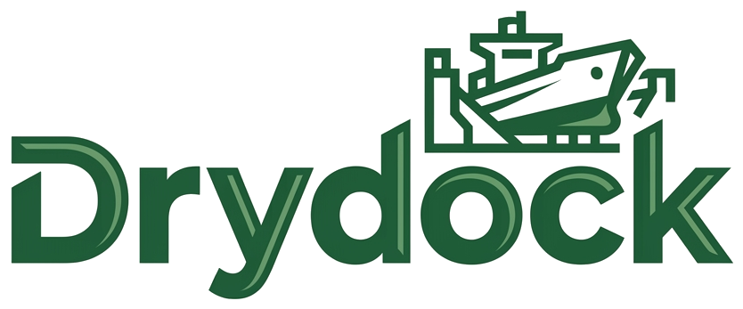
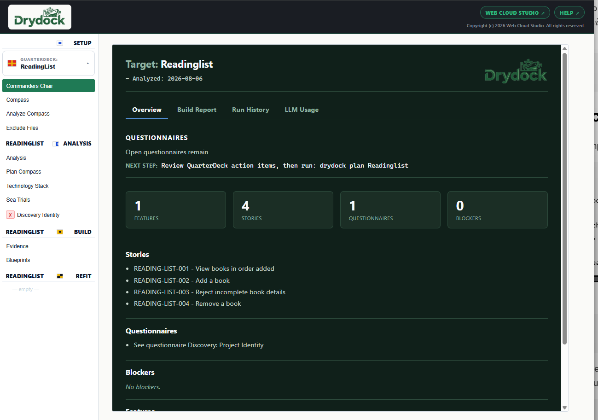

<div align="center">



**Drydock turns specifications into tested working software.**

Specification driven. Agile. Test driven. Dependency-aware builds. Dedicated web console.
Enterprise guardrails.

**Runs on your existing Claude or Codex subscription; Gemini is supported as a metered alternative.**

[](https://pypi.org/project/drydock-sdd/)
[](https://pypi.org/project/drydock-sdd/)
[](LICENSE)

### ▶ START HERE — [Quick Start](https://webcloudstudio.com/project-docs/drydock/QUICK_START.html)

[Specification](https://webcloudstudio.com/project-docs/drydock/index_sections/introduction.html) · [Installation](https://webcloudstudio.com/project-docs/drydock/USER_INSTALLATION.pdf) · [Comparison matrix](https://webcloudstudio.com/project-docs/drydock/papers/Product_Comparison_Matrix.html) · [Overview deck](https://webcloudstudio.com/drydock/) · [Contributing](CONTRIBUTING.md)

</div>

---

## Overview

Target generation supports Python and Go. Select the language and optional database in
`TECHNOLOGY_STACK.md`, approve the stack in QuarterDeck, then plan and build. SQLite and
PostgreSQL use shipped persistence libraries. Go uses standard-library CLI/HTTP layouts and
native tests; SQLite requires CGO and a C compiler. Start a fresh Target to change languages
after planning. Planning and building reject an invalid or unapproved stack before an LLM call.

**Drydock is a repeatable method to turn messy specifications into tested working software.**

Drydock imports your source material, defines stories using agile best practices, and then decomposes your sources into typed blueprints (stories) related using a graph database.  Drydock builds with a context aware compression based algorithm and tests stories with deterministic test driven acceptance criteria.

## Features
- **Builds working software using small, cheap models**
- **Agile Methodology** to decompose buildable stories and for product owner / llm review.
- **Test driven development** with acceptance criteria embedded in each Story/Blueprint.
- **Dependency graph** relates stories and orders builds.
- **QuarterDeck web console** to answer question and review the process
- **Runs on existing subscriptions**
- **Ingests your existing specs and notes in any format**
- **Change management — edit the spec, rebuild only what's affected**
- **Context compression** and **Grouping** for context aware builds.
- **Enterprise guardrails** with embedded branding, best practices, and build gates
- **Generates consistent apps and documentation**

## Drydock Documentation

| Resource | PDF |
|---|---|
| [Quick Start Guide](https://webcloudstudio.com/project-docs/drydock/QUICK_START.html) | [PDF](https://webcloudstudio.com/project-docs/drydock/QUICK_START.pdf) |
| [User Installation Guide](https://webcloudstudio.com/project-docs/drydock/USER_INSTALLATION.pdf) ||
| [Drydock Specification](https://webcloudstudio.com/project-docs/drydock/index_sections/introduction.html) | [PDF](https://webcloudstudio.com/project-docs/drydock/Drydock_Specification.pdf) |
| [CHANGELOG.md](CHANGELOG.md) | — |
| [CONTRIBUTING.md](CONTRIBUTING.md) | — |

## Drydock UAT Examples

The following are 4 WORKING applications built as part of the Drydock Uat Cycle - **BUILD EVIDENCE STORED IN SEPARATE REPOS**

| Project | Description | Web URL | Git URL |
| --- | --- | --- | --- |
| ReadingList | simple web app | https://webcloudstudio.github.io/drydock-example-readinglist/ | [Git](https://github.com/webcloudstudio/drydock-example-readinglist) |
| CommonMark | markdown formatter | https://webcloudstudio.github.io/drydock-example-commonmark/ | [Git](https://github.com/webcloudstudio/drydock-example-commonmark) |
| TOML | markup language | https://webcloudstudio.github.io/drydock-example-toml/ | [Git](https://github.com/webcloudstudio/drydock-example-toml) |
| jq | Flagship - full build of the jq language | https://webcloudstudio.github.io/drydock-example-jq/ | [Git](https://github.com/webcloudstudio/drydock-example-jq) |


All four built with gpt-5.6-luna on a Codex subscription. No API keys.  All build evendence should be in the separate git repo.


## Getting started

**Prerequisites**

- [ ] Python 3.11 or later — `python3 --version`
- [ ] Install `uv`
  - `curl -LsSf https://astral.sh/uv/install.sh | sh` (macOS/Linux),
  - `brew install uv`
  - `winget install --id=astral-sh.uv -e` (Windows)
- [ ] `claude`, `codex`, or `gemini` CLI, authenticated, in your `PATH`
      (`claude --version`, `codex --version`, `gemini --version`). `gemini` authenticates
      with `GEMINI_API_KEY` in the environment and bills per token.

**Install Drydock**

```bash
uv tool install drydock-sdd     # or: pipx install drydock-sdd
drydock --version
```

**Configure Drydock**

```bash
export PROJECTS="$HOME/projects" # main directory you keep your code/projects/git
mkdir -p "$PROJECTS/drydock"     # the drydock workspace

drydock config set drydock_model claude-opus-5  # required; the model selects the provider
                                                # (gpt-5.6-luna -> codex, gemini-3.5-flash -> gemini)
drydock config set drydock_workspace "$PROJECTS/drydock"
drydock config set drydock_build_directory "$PROJECTS"
drydock config show
```

Bounds on a build's acceptance runs are configurable, and each is also a `drydock build` and
`drydock uat` flag that overrides the configured value for one run.

| Key | Default | Bounds |
|---|---|---|
| `repair_attempts` | 6 | Repair passes a failed block may spend (0 disables repair) |
| `repair_stall_limit` | 2 | Consecutive passes without acceptance progress before a block stops |
| `sandbox_mem_limit` | 4096 MB | Address space for an acceptance run and everything it spawns |
| `capture_output_limit` | 8 MB | Output held from one acceptance command before it fails the gate |

```bash
drydock config set repair_attempts 12           # a target that converges slowly
drydock build MyApp --capture-output-limit 64   # a legitimately loud conformance suite
```

Claude output limits are configurable. Drydock passes them to the Claude CLI on every run and
replaces any value inherited from the shell.

| Key | Default | Effect |
|---|---|---|
| `max_output_tokens` | 128000 | Output tokens per response (`CLAUDE_CODE_MAX_OUTPUT_TOKENS`); the CLI caps it at the model maximum (Haiku 64000) |
| `haiku_thinking_tokens` | 16000 | Haiku 4.x thinking budget (`MAX_THINKING_TOKENS`), drawn from the output limit; 0 disables it. Other models, including Haiku 5.5 and the `haiku` alias, size thinking from `--effort` |

A Target whose stack selects `postgres.md` builds against the server named by `postgres_dsn`
(`drydock config set postgres_dsn postgresql://<user>:<password>@<host>:<port>/<database>`).
`drydock build`, `drydock score ac` and `drydock score release` stop with exit 1 when it is not
set; `drydock config show` masks the password. See `docs/HOW_TO_SETUP_POSTGRES.md`.

A text-only command whose response reaches the output limit fails with exit 1 and a
`FATAL ERROR - LLM OUTPUT TRUNCATED` block naming the limit, the thinking spent, the artifact
that was cut, and the setting to change. Nothing from the response is written.

Structured model responses are normalized at the shared CLI adapter when the caller declares
`output_format="artifacts"` or `output_format="json"`. Analyze and planning artifact calls,
score spec/release/drydock, and prompt review use this contract. Short wrapper narration is
removed only around complete payloads; JSON code fences are removed as well. Bodies remain
unchanged. Raw output remains in execution evidence, and `logs/llm.jsonl` records removals and
cleanup defects. An exact final `=== END ARTIFACT` missing its trailing ` ===` is completed only
when the artifact envelopes are otherwise unambiguous; the record's `output_contract.repaired`
field names the repair, and `drydock plan` prints it. Other incomplete planning artifacts remain subject
to validation and bounded retry with the filename and closing-token requirement.
Existing command validators and retry budgets still govern acceptance; malformed
JSON, duplicate keys, and ambiguous extra content are not silently extracted away.

Within one artifact response, a later block with the same filename is a complete replacement
for its earlier draft. The final body receives normal validation; unrelated files are retained.
An unclosed final update requires recovery rather than restoring the earlier draft. All drafts
remain in the original execution evidence, and artifacts accepted in earlier batches stay frozen.

## Build workflow

`init` → `import` → `analyze` → `plan` → `build` → `refit` → `build`

`plan verify` checks whether acceptance criteria can run; it does not establish product coverage.
Criteria must observe the delivered application through its declared interfaces. A check that
passes without the product remains `PREBUILD_PASSES` and cannot verify its story. String
calculations compared with literal known answers are not flagged as retyped expressions;
escaping checks still apply to the literal expectation.

| Stage | Command | What it does |
|---|---|---|
| **init** | `drydock init <Target>` | Initialize Workspace<br>**Creates:** `targets/<Target>` |
| **import** | `drydock import <Target>` | import source material<br>**Creates:** `targets/<Target>/sources` |
| **analyze** | `drydock analyze <Target>` | Decompose into stories, acceptance criteria, questions, and blockers.<br>**Creates:** `ANALYSIS.md`, `SEA_TRIALS.md`, `BLOCKERS.md`, questionnaires. |
| **plan** | `drydock plan <Target>` | Create story blueprints and a graph datbase.<br>**Creates:** `blueprints/` and `MANIFEST.md`.<br>`drydock plan verify <Target>` reports acceptance criteria that cannot run; `drydock plan repair <Target>` makes them runnable in one pass. Citation repair receives numbered source context, preserves the proof, and revalidates the citation; already-binding numeric and plain-text expectations require resolving citations without literal derivation. Go CLI criteria use `drydock_go.cli_runner(*args)` with separate string arguments; planning routes `go run`, direct package-directory launches, and invalid list/tuple arguments through artifact repair before writing the plan. Structured CLI output criteria parse CSV/JSON and assert declared data against fixture inputs. |
| **build** | `drydock build <Target>` | Executes the refit-reconciled Manifest frontier, gated by deterministic acceptance criteria. Failure reports show the complete block acceptance tally and retain criterion disputes across repairs, directing verification before another build. It exits with an error when any applied Blueprint changed or disappeared; run `drydock refit <Target>` first. Test-scoped Python acceptance dependencies are automatically authorized; runtime dependencies and external executables remain governed.<br>**Creates:** `\$drydock_build_directory/<Target>` with working software. |
| **refit** | `drydock refit <Target>` | Reconcile edited Blueprints to the Manifest dependency graph; reset only their affected build frontier. Change tickets remain available for additive work. `drydock refit add <Target> <Blueprint> <File>` appends the next REFIT ticket, `blueprint/<Blueprint>_refit_<NNN>.md`, and its Manifest story with inherited context, stack, and Rigging rules. Both commands automatically optimize unbuilt work in computed Manifests by shared context savings, including tickets from earlier calls. Started blocks retain their membership and numbering.<br>**Updates:** `MANIFEST.md`; continue with a `build`. |

## The Drydock CLI

`ai` calls your subscription CLI agent; all other commands are deterministic.

```text
# ── S ── SET UP ──────────────────────────────────────────────────────────
    drydock config show                        # Show configuration values and sources
    drydock config set        <var> <value>    # Set a configuration value
    drydock init              MyApp            # Create the target workspace
    drydock status                             # Status dashboard
    drydock status            MyApp            # Summary and plan state
    drydock report help                        # List deterministic Target reports
    drydock report manifest  MyApp             # Write a compact Manifest report
    drydock report token     MyApp             # Prompt size, model, and run time per LLM call
    drydock report --all                       # Write all reports for all Targets
    drydock report --all     MyApp             # Write all reports under targets/MyApp/reports/
    drydock report uat_report                  # Passed UAT runs: calls, tokens, tools, time
    drydock report uat_summary                 # 30-day passed-kit matrix: Claude / Codex

# ── A ── ANALYZE ─────────────────────────────────────────────────────────
    drydock import            MyApp <file|dir> # Import sources into the workspace
ai  drydock analyze           MyApp            # Epic decomposition into stories & blockers
    drydock validate          MyApp            # Validate Build Plan
ai  drydock score spec        MyApp            # Audit imported raw specifications
    drydock run quarterdeck   MyApp            # Web interface
ai  drydock plan              MyApp --model sonnet --lineage-model haiku
                                                # Grooming and dependency graph; optional lower-cost lineage pass
    drydock plan verify       MyApp            # Report acceptance criteria that cannot run
ai  drydock plan repair       MyApp            # One pass making those criteria runnable

# ── I ── IMPLEMENT ───────────────────────────────────────────────────────
ai  drydock build             MyApp            # Iterative context-aware process
ai  drydock score release     MyApp            # Score project success criteria (EARS)

# ── L ── LOOP ────────────────────────────────────────────────────────────
ai  drydock diagnose          MyApp            # Root cause; propose Blueprint repairs (known terminal failures do not call an LLM)
ai  drydock refit             MyApp            # Blueprint drift -> affected build frontier
```

`drydock plan` freezes the topology before authoring Blueprints in batches of at most five.
Each Claude Blueprint batch starts with the original planning inputs, frozen topology and
decisions, current work ledger, and cumulative database declaration where present. Earlier
batch conversations are not carried forward. Stage 1 corrective calls still resume their session.

### Additional Commands

`drydock diagnose <Target> --apply` exercises delegated Commander authority to repair
specification and acceptance defects. It reads complete decision records once, prints proposed
diffs, validates acceptance syntax without executing generated code, and resets affected
consumers for rebuild. Repaired malformed-criterion blockers are retired; the next build still
verifies behavior. Routine corrections are annotated in the diagnosis report. Consequential
choices are recorded in `DECISIONS.json` for QuarterDeck review without blocking execution.
Commander answers remain binding. An unresolved stall or failed repair returns exit 1.

Use the recovery loop for unfinished Targets, including those already stalled before build:

```bash
bash drydock_build_loop.sh "$PROJECT" --model gpt-5.6-luna
```

The loop builds available work and invokes diagnosis after a failed build or an unfinished
Target with no buildable frontier. It stops if diagnosis fails or leaves the Target stalled.
`DRYDOCK_RUNNER_MAX_BUILDS` bounds iterations (default 5). Provider/model flags reach both
commands. `drydock_runner.sh` uses this loop after preparing the Target, and accepts only a
fixed list of models, printing that list with each model's cost when given anything else.
The loop ends at verified build completion; scoring is separate. `status --ready` retains its
boolean buildability contract, and `status --check` supplies the separate completion check.

`<Target>/BLOCKERS.md` is the one file that blocks a Target. A rate or usage limit, expired
login, timeout, outage, invalid model, or unrunnable provider CLI writes an environmental blocker
owned by the command that hit it; `analyze` and `refit` write decision blockers that ask the
Commander a question. While the file exists only its owner runs, and `status`, `run`, and `uat`
are exempt. `status --ready` prints `BLOCKED: <Target>` and exits 1, and `drydock status <Target>`
ends with the blockers banner. At a terminal a blocked command asks `How should we proceed?` per
blocker, writes the answer as its `Commander Resolution`, reruns the owner with the resolutions
as its primary instruction, then continues. Unattended, the owner reruns only when every decision
is resolved and every environmental blocker may auto-continue (a timeout, an outage, or a rate
limit past its stated reset), once. `plan --override` passes an analysis decision only.

Fatal provider failures exit `1` with the recorded blocker and error last on the console;
planning does not turn them into generation stalls. UAT reports show recorded blockers and
failed workflow attempts explicitly and distinguish conformance that was not executed from
missing configuration. UAT stops even when the failing child is an optional verification or
repair step, and an environmental halt ends a multi-kit sweep before
the next kit starts. Receipts, report links, and checkpoints precede the final blocker error,
including with `--quiet`. The UAT repair loop also stops without starting a repair session and
ends by repeating the recorded failure.
`drydock_build_loop.sh` checks the Target's `BLOCKERS.md` before further build or diagnosis
work and exits `1` with the blocked cause last; `drydock_runner.sh` propagates that halt.

`drydock build` checkpoints the application and Target Git repositories after each agent
execution (including repairs and failures) and completed step. Existing changes receive a
separate baseline checkpoint. Git uses the configured author identity, respects ignored files,
and never pushes. Full resets preserve application Git history.

`<Target>/BUILD_LINEAGE.jsonl` appends mechanical execution and `step_completed` records:
UTC run/execution timestamps, run and step IDs, Manifest nodes with their original fields,
`implements:` specification paths and hashes, acceptance results, available token statistics,
execution artifact paths, the command transcript, application commit SHAs, and Git file changes
(added, modified, deleted, renamed). Context, dependencies, and compacts are not attributed as
built specifications. Repeated executions retain separate rows; no model attribution is requested.
Completed-step records capture final story states and deterministic outputs; their statistics are
null so token totals count execution rows once. Ignored files and byte-identical rewrites have no
committed delta. The association is between an execution's specification set and its file delta.

Commit lines use the same block and `implements:` names as lineage:
`git: block-3 | SCREEN.md, SERVICE.md | call=2 | app=<sha> target=<sha>`.
An unchanged application reports `app=unchanged`. Target commits carry `Build-Lineage-Id`
and `Build-Run-Id` trailers: the receipt cannot contain the SHA of the commit containing itself.
Pending receipts survive checkpoint failures. The next build completes a confirmed application
checkpoint's Target receipt; an unconfirmed application commit stops for inspection instead of
inventing attribution. Command epilogue outputs receive a separate completion checkpoint.

```text
    drydock build status      MyApp            # Show build state
ai  drydock diagnose          [MyApp] --apply  # Delegated repair; important decisions enter QuarterDeck review
ai  drydock diagnose          [MyApp] --no-apply # Record amendments as decisions; change nothing
ai  drydock uat               [Project]        # Scored UAT testing
    drydock uat status        <Project>        # Current run, failure, and recovery command
ai  drydock uat resume        <Project>        # Resume the current failed run
ai  drydock uat resume        <Project> --from <stage> # Re-enter a named lifecycle stage
    drydock uat report        [Project]        # Rebuild UAT HTML proof kits
    drydock uat <Project> --steps              # List a run's numbered steps and their stages
ai  drydock uat <Project> --from-step <n>      # Resume at the stage that owns recorded step <n>
ai  drydock document          MyApp            # Project documentation automation
ai  drydock document generate MyApp            # AI pass only
    drydock document assemble MyApp            # Assembly only
    drydock publish           <Source.md>      # Render Markdown to HTML/PDF
ai  drydock rigging compact [MyApp]            # Refresh stale shipped Rigging; add Target if given
    drydock rigging verify                     # Verify rigging compliance
    drydock score ac          MyApp            # Verify Story acceptance criteria
    drydock score build       MyApp            # Post-build report: repairs, tokens, cache
    drydock score llm         [MyApp]          # Successful LLM usage since latest init; by stage/model
    drydock score llm MyApp --all              # All recorded LLM executions, including failures
    drydock score report      MyApp            # Publish the build receipt with its evidence
    drydock score             MyApp            # Summarize the scores above: last run, result,
                                               #   and output file
ai  drydock score drydock                      # Adversarial self-assessment
```

Each selected `uat/<Project>/` directory is an independent Git repository. `drydock uat`, resume
stages, and `drydock uat report` attempt to initialize it when absent and commit kit changes before
exit. Git checkpoint failures are silent and do not change the command's result.
UAT run receipts report the models recorded for executed LLM calls; a requested `--model` is
retained separately in `result.json`. A run that used multiple models lists each in first-use order.

`$ddk-uat <Target>` investigates warnings and recovered errors as well as terminal failures,
including in successful or running UAT runs. Its diagnosis reports operational success and clean
execution separately, traces upstream warnings through later artifacts and failures, and keeps
recovered defects open until a corrected run reaches the affected stage without recurrence.

## Target reports

`drydock report help` lists report names, commands, and descriptions. `drydock report <name>
<Target>` writes one deterministic text report. `drydock report --all` writes status, Manifest,
run state, build evidence, command history, LLM usage, and score history for every initialized
Target under `targets/<Target>/reports/`; `--all <Target>` limits the run to one Target. The CLI
prints each path relative to the current directory when it can. These reports read recorded
evidence and do not run models, builds, acceptance checks, or UAT. Existing QuarterDeck views
and published receipts remain available through their current commands.

`drydock report uat_summary` prints `# 30 Day UAT Summary Report` followed by an aligned
kit matrix with Claude and Codex columns. `Y` means at least one passed run completed in the
preceding 30 days (UTC); otherwise the cell is blank. Older receipts without completion time
use the UTC run id. Every kit directory is listed, including kits without recent passes; files
such as `README.md` are excluded. The report reads only `result.json` receipts under
`<workspace>/uat/`, writes no files, takes no Target, and is excluded from `--all`.

## The QuarterDeck Web Server

QuarterDeck is the Agile web surface between the Commander (product owner) and Crew (LLM agents).

```bash
drydock run quarterdeck <Target>
```



## Glossary

| Term | Meaning |
|---|---|
| **Target** | One project managed by Drydock, held in its own workspace directory. |
| **Blueprint** | The typed specification for one story: scope, contracts, and acceptance criteria. |
| **Manifest** | `MANIFEST.md`, the dependency graph that relates and orders the Blueprints. |
| **Sea Trials** | Product-level objectives and proof-of-delivery criteria — the release gate. |
| **Soundings** | The per-story acceptance-criterion verification board. |
| **Scorecard** | `SCORECARD.md`, the recorded release scoring results, verdicts, and blockers. |
| **QuarterDeck** | The web console used to review and direct each phase. |
| **Commander** | You — the product owner who approves the work. |
| **Crew** | The LLM agents that perform the work. |

## Contributing

Help test Drydock on real projects. Open [issues](https://github.com/webcloudstudio/Drydock/issues). See [CONTRIBUTING.md](CONTRIBUTING.md).

## License (See LICENSE)

```
MIT License

Copyright (c) 2026 Web Cloud Studio

Permission is hereby granted, free of charge, to any person obtaining a copy
of this software and associated documentation files (the "Software"), to deal
in the Software without restriction, including without limitation the rights
to use, copy, modify, merge, publish, distribute, sublicense, and/or sell
copies of the Software, and to permit persons to whom the Software is
furnished to do so, subject to the following conditions:

The above copyright notice and this permission notice shall be included in all
copies or substantial portions of the Software.

THE SOFTWARE IS PROVIDED "AS IS", WITHOUT WARRANTY OF ANY KIND, EXPRESS OR
IMPLIED, INCLUDING BUT NOT LIMITED TO THE WARRANTIES OF MERCHANTABILITY,
FITNESS FOR A PARTICULAR PURPOSE AND NONINFRINGEMENT. IN NO EVENT SHALL THE
AUTHORS OR COPYRIGHT HOLDERS BE LIABLE FOR ANY CLAIM, DAMAGES OR OTHER
LIABILITY, WHETHER IN AN ACTION OF CONTRACT, TORT OR OTHERWISE, ARISING FROM,
OUT OF OR IN CONNECTION WITH THE SOFTWARE OR THE USE OR OTHER DEALINGS IN THE
SOFTWARE.
```

### Language bundles

Python and Go instructions live in `Rigging/languages/<language>/`, with their compact contracts
and acceptance helpers. Select the existing `python.md` or `go.md` name in the technology stack.
Go tests execute through `drydock_go.run_test` inside Blueprint ACs; skipped or absent tests do
not pass. Persistence implementation files are described by each language's contract.

Python and Go both generate persistence from `DATABASE.md`, using bundled SQLite/PostgreSQL
libraries. Plan authors the database declaration separately and freezes it before dependent
Features consume its compact contract. Missing source-declared tables, columns, and composite
constraints are restored; changed source column contracts are rejected during planning.
Go requires an existing `go.mod`, downloaded pinned drivers, CGO and a C compiler for
SQLite. Drydock links the generated `persistence/` module and applies schema through its command.
Select exactly one language and zero or one database engine. Existing-table migrations and
automatic per-criterion code tracing remain separate capabilities.

### Persistence acceptance lifecycle

The DATABASE build step provisions the configured application store and records runtime schema
verification in `evidence/persistence-verification.json`: every declared table is readable with a
nonnegative row count, and declared columns, constraints and indexes pass catalog checks.
Subsequent acceptance runs verify that store without recreating it. Missing or incompatible schema
fails the build with a persistence diagnostic; rebuild the DATABASE step after correcting its cause.

Application operations retain autocommit. The acceptance harness owns isolation: it begins one
transaction before each Python criterion and rolls it back when the criterion ends, pass or fail.
Every database the criterion's process opens joins that transaction, including
`persistence.testing.db_session()`, the application behind `web_client()`, and commands run
through `cli_runner()`, so setup, behavior and readback see one another's writes and none
persists. Criteria never commit or clean up, and assert relative to data already in the store. A
process a criterion launches cannot see the transaction, so `drydock plan verify` rejects a
criterion that both opens the store and launches a process. Go criteria use `OpenSession(ctx, "")`
and check the deferred cleanup error. `drydock plan verify` also rejects recognized DSN overrides
and schema application in criteria. `VERIFICATION.md` is an accepted standard release-gate Blueprint filename.
