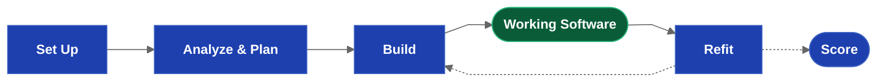
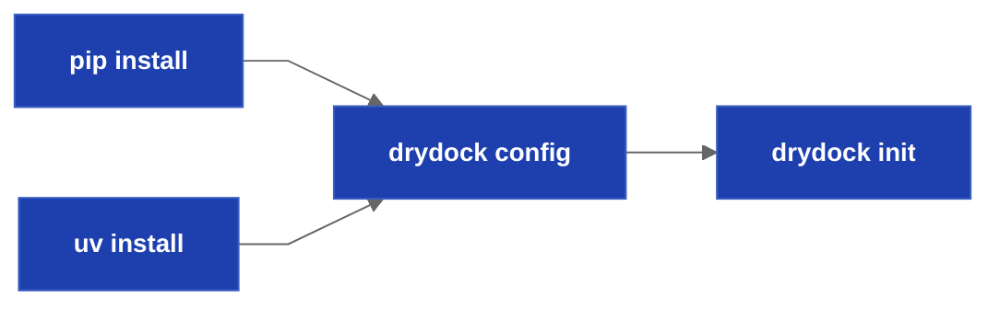
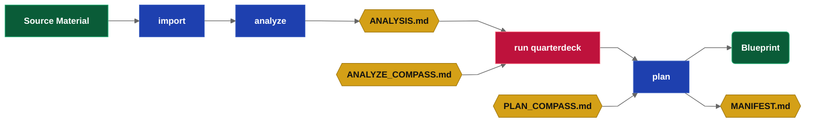
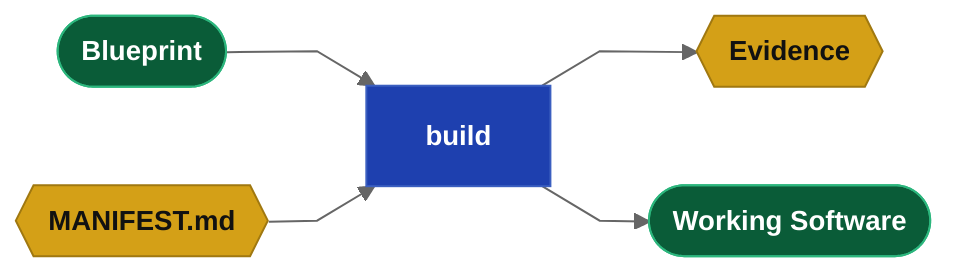
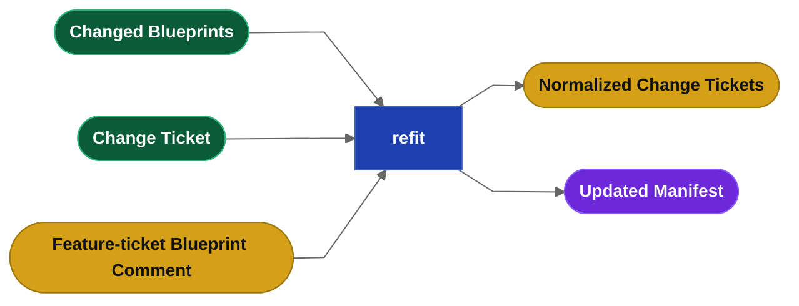

## What is Drydock

Drydock is a specification-driven software build pipeline.

The user is the **Commander**, who owns the product direction, reviews the work, and approves decisions.

Drydock imports specifications for your project in any format.

Drydock turns this material into **Blueprints**, the authoritative living definition of your software product. `drydock plan` writes the **Blueprints** and a **Manifest** (graph database) that tracks build order, runnable work, and incremental rebuild scope.

**Blueprints** represent the smallest **building block** of your software. Drydock groups related **building blocks** into **blocks**: atomic build steps that combine the **Blueprints** with **Rigging**. **Rigging** is enterprise business rules, technology rules, stack guidance, and branding. It gives your software common behavior and style.

Drydock uses test-driven development: each **building block** carries acceptance criteria that must pass before the next step.

The process builds maintainable software. Users edit specifications or add change tickets, run `drydock refit`, and rebuild normally.

`drydock score` commands verify quality deterministically against programmatic acceptance criteria, so the **Commander** knows the quality of the output software.

The **QuarterDeck** is a web console where the **Commander** understands and guides the build. It shows blockers, decisions, questionnaires, and build progress.



### Glossary

| Drydock term | Meaning |
|---|---|
| **Commander** | The operator. The Agile Product Owner. |
| **Target** | The named project under `$DRYDOCK_WORKSPACE/targets/<Target>`. |
| **Blueprint** | The Typed Specification files that define the product. The source of truth. |
| **Manifest** | The executable build plan and dependency graph, `MANIFEST.md`. |
| **Frontier** | The set of **Manifest** blocks that are runnable now. |
| **QuarterDeck** | The web review console between the **Commander** and the LLM process. |
| **Compass** | Persistent project guidance used by Drydock commands. |
| **Rigging** | Shared branding, stack rules, templates, and compact context derivatives. |
| **Soundings** | The per-story acceptance-criterion verification board. |
| **Sea Trials** | Product-level objectives and proof-of-delivery criteria. |
| **Refit** | Change process that maps updates into the **Manifest**. |
| **Crew** | The LLM agents that perform the work. |
| **Building Block** | A story representing the smallest buildable specification. |
| **Block** | A group of **Manifest** stories built as one unit. |
| **Tier** | A **Rigging** file's or story's rank in the build order. |

## The drydock CLI

```text
drydock <verb> [<sub-verb>] [arguments] [--options]
```

Each **Target** has a workspace at `$DRYDOCK_WORKSPACE/targets/<Target>` and builds to `$DRYDOCK_BUILD_DIRECTORY/<Target>`. LLM actions are scoped to these directories.

## End-to-End Command Flow

A **Target** runs from source material to a scored release, then through change, with these commands.

### S — Set Up

```bash
drydock init MyApp                  # create the workspace
```

### A — Analyze and Plan

```bash
drydock import MyApp ./notes        # load specifications
drydock analyze MyApp               # stories, questions, blockers
drydock run quarterdeck MyApp       # review and answer
drydock plan MyApp                  # Blueprints and Manifest
drydock plan verify MyApp           # check acceptance criteria run
                                    # on failure: drydock plan repair MyApp
drydock run quarterdeck MyApp       # review the Manifest
```

### I — Implement

Build until the **Manifest** is complete:

```bash
n=1
max=5
while drydock status MyApp --ready
do
    echo "*** BUILD ATTEMPT $n ***"
    drydock build MyApp || drydock diagnose MyApp --apply || true
    n=$((n+1))
    if [ "$n" -ge "$max" ]
    then
        echo "hit $max build attempts - aborting"
        exit 1
    fi
done
drydock status MyApp --check        # Manifest complete
```

Score the result:

```bash
drydock score ac MyApp              # story acceptance
drydock score build MyApp           # build evidence
drydock score release MyApp         # release gate
```

### L — Loop

```bash
drydock refit MyApp                 # map changes into the Manifest
                                    # then rerun the build loop
```

## SAIL Phase 1 — Set Up: Laying the Keel

Install Drydock, configure runtime defaults, and create a workspace for a **Target**.
Process environment variables override values in Drydock's user-scoped `.env`.



### Installation 

**Prerequisites**

- Python 3.11 or later
- A subscription-authenticated CLI: `claude` (Anthropic) or `codex` (OpenAI), or the token-billed `gemini` (Google).

**Install**

```bash
uv tool install drydock-sdd
# or: pipx install drydock-sdd
```

Note: `uv tool` and `pipx` place `drydock` on `$PATH` automatically.

**Configure the workspace**

`$PROJECTS` is the directory for your built software.

```bash
drydock config set drydock_workspace "$PROJECTS/drydock"
drydock config set drydock_build_directory "$PROJECTS"
```

**Initialize the target workspace**

```bash
drydock init <Target>
```

The resulting layout:

```text
$PROJECTS/
├── drydock/                    # Drydock workspace
│   └── targets/<Target>/       # Created by drydock init - Project Workspace
└── <Target>/                   # Final Build Location for projects
```

### General Setup Commands

```text
drydock --help
drydock --version
drydock config show
drydock config set <key> <value>
drydock init <Target> [--display-name <name>] [--description <desc>]
drydock status [<Target>] [--check | --ready]
drydock run quarterdeck [<Target>] [--host HOST] [--port PORT]
```

### drydock status

`drydock status` shows the status of every initialized project. `drydock status <Target>` shows one **Target**.

`drydock status <Target> --check` and `drydock status <Target> --ready` are deterministic pipeline
gates that report whether the project has work to do. Neither calls an LLM or writes files.

`--check` reports the terminal state
`--ready` is the build-loop guard.

### drydock config

`drydock config` sets user-scoped defaults.

| Variable | Purpose |
|---|---|
| `drydock_build_directory` | Build root |
| `drydock_workspace` | Workspace root |
| `change_ticket_directory` | Refit ticket directory |
| `drydock_model` | Default model |
| `drydock_effort` | Reasoning effort |
| `drydock_build_escalate_model` | Model for the final repair attempt |
| `llm_provider` | LLM CLI: `claude`, `codex`, or `gemini` |
| `codex_sandbox` | Codex OS sandbox policy |
| `prompt_warn_tokens` | Prompt size that warns |
| `prompt_error_tokens` | Prompt size that fails |
| `block_min_savings` | Shared tokens needed to group two stories |
| `quarterdeck_port` | QuarterDeck port |
| `diagnose` | Diagnose failures automatically |
| `sandbox_mem_limit` | Acceptance-run memory cap (MB) |
| `capture_output_limit` | Captured command output cap (MB) |
| `repair_attempts` | Repair passes per failed block |
| `repair_stall_limit` | Passes without progress before repair stops |
| `max_output_tokens` | Output tokens per response |
| `haiku_thinking_tokens` | Haiku thinking budget |

### drydock init

`drydock init <Target>` creates the **Target** workspace under `$DRYDOCK_WORKSPACE/targets/`. `--display-name` sets a human-readable project name. `--description` seeds the one-line project summary in **Target** metadata.

## SAIL Phase 2 — Agile Analyze: Charting the Course

Analyze turns imported source material into an Analysis for review, then into an executable **Manifest** for build.

1. `drydock import` brings source material into the Drydock workspace.
2. `drydock score spec` (optional) scores your imported specifications.
3. `drydock analyze` derives stories, acceptance milestones, blockers, and questions.
4. `drydock run quarterdeck` starts the web server for **Commander** review.
5. `drydock plan` creates the **Blueprint** files and the **Manifest**.

### Analyze Commands

```text
drydock import <Target> <Source> --format <auto|markdown|source|speckit|compass> [--force]
drydock score spec <Target>
drydock analyze <Target>
drydock run quarterdeck [<Target>] [--host HOST] [--port PORT]
drydock plan [--overwrite] [--no-conform] <Target>
```



### drydock import

`drydock import <Target> <Source> --format <auto|markdown|source|speckit|compass>` is the intake step.
It copies external source material into the **Target** workspace for analysis. Compass imports write
`COMPASS.md` at the **Target** root.

```text
drydock import <Target> <Source File> --format markdown
drydock import <Target> <Directory> --format markdown
drydock import <Target> <Source> --format <source|speckit>
drydock import <Target> <Source> --format compass [--force]   # --force replaces COMPASS.md
drydock import <Target> --update
```

`--update` refreshes the imported snapshot from the recorded source root and records a new source
version

Imported source files must be UTF-8. a file that fails UTF-8 decoding is not analyzed.

### drydock score spec

`drydock score spec <Target>` diagnoses potential specification errors.

### drydock analyze

`drydock analyze` decomposes imported source material into stories, questionnaires, and blockers.

**Input files**

| Artifact | Location | Purpose |
|---|---|---|
| `sources/*` | `blueprint/` | Read-only imported source material |
| `*COMPASS.md` | Target root | Project guidance and intent |
| `ANALYZE_COMPASS.md` | Target root | Guidance for `drydock analyze` |
| `BLOCKERS.md` | Target root | Identified blockers (from prior runs) |
| `questionnaires/*.json` | `QuarterDeck/` | Persistent questionnaires created by `drydock analyze` |

**Output files**

| Artifact | Location | Purpose |
|---|---|---|
| `BLOCKERS.md` | Target root | Questions on blockers the LLM found. Existence implies blockers. Edit to resolve them. |
| `ANALYSIS.md` | Target root | Decomposition, story list, blockers, questions, and recommendations |
| `SEA_TRIALS.md` | Target root | Project acceptance criteria and release objectives |
| `COMPASS.md` | Target root | Created if absent. Constitution/Intent. |
| `questionnaires/*.json` | `QuarterDeck/` | **Commander** questionnaires |
| `commanders_chair.html` | `QuarterDeck/` | Summary view |

`BLOCKERS.md` halts the build. The **Commander** edits it (manually or in the **QuarterDeck**) and
reruns `drydock analyze` until the blockers clear. `SEA_TRIALS.md` captures project success criteria.

### Epic Decomposition 

Drydock decomposes source material into **Blueprints** by project type. A web application decomposes
by route: stories build the routes and the screens, and a screen can use multiple routes. Other
system types decompose as follows.

| System Type | Methodology |
|---|---|
| Web application | HTTP routes — `GET /catalog` |
| CLI tool | Commands and sub-verbs |
| Library or package | Public API contract — `Database.items.get` |
| Data pipeline | Datasets, tables, process, inputs, and outputs |
| Event-driven | Topics, queues, and event types |

### Story Refinement 

> **Definition — QuarterDeck**
>
> The **QuarterDeck** is a web console that renders the LLM's Markdown output. The **Commander** uses
> it to communicate with the **Crew**.

`drydock run quarterdeck` starts the web console, your helm, at the listed host and port.

The **QuarterDeck** shows status, blockers, questionnaires, decisions, and activity on interactive
screens where the **Commander** approves or responds.

The **Commander** defines the technology stack in the **QuarterDeck** by selecting **Rigging**, which
is required to build and use each component technology.

### drydock plan

`drydock plan` converts the reviewed analysis into **Blueprints** under `<Target>/blueprint/` and
writes the build graph (`MANIFEST.md`).

**Input files**

| Artifact | Location | Purpose |
|---|---|---|
| `sources/*` | `blueprint/` | Imported sources |
| `ANALYSIS.md` | Target root | Reviewed analysis |
| `PLAN_COMPASS.md` | Target root | Planning and grouping guidance |
| `COMPASS.md` | Target root | Project guidance |
| `questionnaires/*.json` | `QuarterDeck/` | Resolved decisions |
| `SEA_TRIALS.md` | Target root | Project acceptance criteria |

**Output files**

| Artifact | Location | Purpose |
|---|---|---|
| `ARCHITECTURE.md`,<br> `DATABASE.md`,<br> `FEATURE-{Name}.md`,<br> `SCREEN-{Name}.md`,<br> `UI-GENERAL.md` | `blueprint/` | Blueprints |
| `MANIFEST.md` | Target root | Build plan |

#### Build Order by Tier

`drydock plan` orders the build by **Tier**, in the order below. Tiers 1 to 5 are the foundation,
each building on the tier before it. Tier 6 is the application. Every **Rigging** file declares a
`**Tier:**` header, and a **Target** selects at most one **Rigging** file per kind. A **Rigging**
file or story with no tier is tier 6.

| Tier | Name | Builds |
|---|---|---|
| 1 | `language` | The tree, the environment, the test runner. |
| 2.1 | `platform` | The one database. |
| 2.2 | `platform` | The one web server. |
| 2.3 | `platform` | The one command-line entry point. |
| 3 | `branding` | The palette, the typography, the voice. |
| 4 | `interface` | The shared UI shell. |
| 5 | `screen-foundation` | The screen idiom. |
| 6 | `application` | Every service and every screen. |

Multiple tiers are generally not built together: their context is not duplicated, so combining them
yields no context savings.

#### Database Encapsulation

**`DATABASE.md` enforces data access encapsulation.**

Application code never calls the database directly. It reaches every table, config store, file
store, and external service through a typed Python class. Route and business code calls
`db.items.get(id)`, never raw SQL.

A code review fails on raw SQL, `os.environ` reads, `open()` on application data, or a cloud SDK
import outside its encapsulation class.

## SAIL Phase 3 — Implement: Building The Software

Implement builds the **Blueprints** using the **Manifest**.

* `drydock build status <Target>` shows each **block**'s state and the runnable **Frontier**.
* `drydock build <Target>` runs the ready **blocks**.
* `drydock score` measures delivery health.
* **Rigging** applies company standards and branding.

### The Manifest

The **Manifest** is the build plan. It groups similar **building blocks** into **blocks** by token
count to maximize context savings, and orders stories by dependencies.

The **Commander** reviews `MANIFEST.md` in the **QuarterDeck** to set build direction and instructions:

* reorder stories so important or testable steps run first
* regroup stories so one agent runs them
* review **Blueprint** programmatic and user acceptance

### drydock build

```text
drydock build <Target> [--continue] [--step <id|name>] [--story <id|name>]
                       [--ungate] [--reset] [--dry-run] [--build-dir <path>]
                       [--repair-attempts <n>] [--escalate-model <model>]
drydock build status <Target>
```

`drydock build` converts **Blueprints** to code, executing ready **blocks** from `MANIFEST.md` in order.

Each **building block** is checked against its deterministic acceptance criteria. A **block**
completes only when all pass. `drydock build` self-repairs: it diagnoses and fixes failed **blocks**,
then resumes.

A failed **block** gets a configurable number of repair passes (default 6). Repair stops after two
consecutive passes without progress, or at the pass limit.

**The build loop**

Analyze decomposes your epic and inputs, plan grooms the stories and adds acceptance criteria, and
build iterates the stories and builds them. `drydock diagnose` may fix your specifications and
correct prior-step errors so the build can retry. Decisions appear in the **QuarterDeck**.

```bash
n=1
max=5
while drydock status "$PROJECT" --ready
do
    echo "RUNNING BUILD ATTEMPT $n"
    drydock build "$PROJECT" $OPTS || drydock diagnose "$PROJECT" --apply
    n=$((n+1))
    if [ "$n" -ge "$max" ]
    then
        echo "ERROR - hit $max build iterations"
        exit 1
    fi
done
```

`drydock diagnose` writes a diagnostic report and recommends **Blueprint** changes. `--apply` updates
the **Blueprints** and invalidates their build graph, so the build self-repairs and continues.

The **QuarterDeck** surfaces these decisions. Review is generally pro forma: `drydock diagnose` knows
your intent from your **Compass** files.



`drydock build <Target>` writes the application to `$DRYDOCK_BUILD_DIRECTORY/<Target>`.
`build_dir:` in `METADATA.md` overrides the location.

| Flag | Effect |
|---|---|
| `--reset` | Discard prior work |
| `--repair-attempts <n>` | Repair passes after a failed block (default 6) |

Before building, `drydock build` checks applied **Blueprint** files for changes and possibly 
directs the **Commander** to `drydock refit`.

### drydock score

```text
drydock score spec <Target>
drydock score ac <Target> [--step <id>] [--full]
drydock score build <Target>
drydock score release <Target>
drydock score report <Target>
drydock score <Target>
```

`drydock score` audits specifications, verifies acceptance, reports build evidence, and evaluates
release readiness.

| Command | Behavior |
|---|---|
| `score spec` | Advisory findings on imported sources. Writes `SPECIFICATION_SCORECARD.md` |
| `score ac` | Verifies every acceptance criterion, with no LLM. Writes `SOUNDINGS.md` |
| `score build` | Reports repairs, tokens, and cache hit rate |
| `score release` | Runs the acceptance gate, then an LLM judges `SEA_TRIALS.md` |
| `score report` | Publishes the build receipt to `drydock_receipt/index.html` |
| `score <Target>` | Summarizes the last run of each score |

### drydock document

```text
drydock document generate <Target> [--model <model>]
drydock document assemble <Target> [--theme <theme>]
drydock document <Target> [--model <model>] [--theme <theme>]
drydock document assemble readme <Target>
```

`drydock document` creates **Target** documentation from the **Blueprint**.
`drydock document assemble` builds browsable documentation from those files.
`drydock document <Target>` runs `generate`, then `assemble`.
`drydock document assemble readme` regenerates the built project's `README.md`.

Configuration lives in `$DRYDOCK_WORKSPACE/targets/<Target>/documentation.yaml`:

```yaml
theme: slate
sections:
  - OVERVIEW
  - FEATURES
  - SCREENS
  - ARCHITECTURE
  - SCHEMA
  - FLOWS
  - PIPELINE
  - SIGNALS
```

Themes are `slate`, `harbor`, and `paper`.

### drydock publish

```text
drydock publish <Source.md> --output <Output.html> [--theme <theme>] [--flatten]
                [--pdf] [--pdf-output <Output.pdf>]
```

`drydock publish` deterministically renders a front-matter Markdown document to HTML without an LLM.
Front matter sets the title, author, studio, cover text, theme, and formatting.

`--flatten` publishes each H1 and H2 section as a separate page with navigation.
`--pdf` renders a PDF with the local browser.

```bash
drydock publish docs/Drydock_Specification.md --output docs/index.html
drydock publish docs/Drydock_Specification.md --output dist/Drydock_Whitepaper.html --theme sail --pdf
```

## SAIL Phase 4 — Loop: The Refit

A **Refit** updates the **Manifest** from **Blueprint** changes and change tickets, creating new nodes
for a normal build.

### Build Commands

```text
drydock diagnose <Target>
drydock diagnose <Target> --apply
drydock diagnose <Target> --no-apply
drydock diagnose <Target> --run <stamp>

drydock refit <Target>
```



### drydock diagnose

`drydock diagnose` writes a report explaining failed builds and authorizes the LLM to create
**Blueprint** diffs that let the next build proceed.

The report contains Root Cause, Details, Commander Feedback Requested, and a Repair Proposal.
Commander Feedback Requested lists the next steps and asks how to proceed.

`--apply` applies the diffs and records decisions in `DECISIONS.json`.

### drydock refit

`drydock refit <Target>` maps changes into new **Manifest** stories. Changes are tickets (Jira or
plain English), direct **Blueprint** edits, and Feature-ticket **Blueprint** comments.

## Directory Layout

Each **Target** has a workspace at `$DRYDOCK_WORKSPACE/targets/<Target>` and builds to
`$DRYDOCK_BUILD_DIRECTORY/<Target>`. The **QuarterDeck** reads its configuration and Markdown from the
workspace.

```text
$DRYDOCK_WORKSPACE/                       
├── logs/                                 
└── targets/
    └── <Target>/                         # one per project
        ├── METADATA.md                   # identity
        ├── README.md                     
        ├── ANALYSIS.md                   # output of analyze 
        ├── ANALYZE_COMPASS.md
        ├── BLOCKERS.md
        ├── COMPASS.md                    # intent, constraints, guardrails
        ├── MANIFEST.md                   # the build graph
        ├── PLAN_COMPASS.md
        ├── SCORECARD.md                  
        ├── SEA_TRIALS.md                 # project-level acceptance criteria
        ├── SOUNDINGS.md                  # detailed acceptance criteria 
        ├── blueprint/                    # the Blueprint — conformed Typed Specification
        │   ├── sources/                  # imported material
        │   ├── *.md
        │   └── changes/
        │       └── TICKET-NNN-{Name}.md
        └── QuarterDeck/                  # web console
```

```text
$DRYDOCK_BUILD_DIRECTORY/
└── <Target>/                             # built software
```

## The Manifest Graph Database

`drydock plan` creates the build graph in `MANIFEST.md`, which the **Commander** manages in the
**QuarterDeck**. The **Manifest** groups **building blocks** into **blocks**, sets build order, and
tracks context and build status.

### Grouping Blocks

The optimizer groups **building blocks** to share context. A **block** builds as one unit, runs when
its dependencies are `closed/verified`, and closes when all its stories pass.

## The QuarterDeck — Agile Development Console

The **QuarterDeck** is where the **Commander** reviews LLM build output and makes decisions. Its
screens follow the Agile methodology and are documented in `QuarterDeck/README.md`.

**Standard artifacts.**

| Artifact | Purpose |
|---|---|
| **Commanders Chair** | Default view: mission and current state |
| **Soundings** | Acceptance checklist: each capability, its state, and evidence |
| **Sea Trials** | Objectives and success criteria for delivery |
| **COMPASS Files** | Persistent **Commander** guidance |

`drydock init <Target>` enables the **QuarterDeck**.

**Blockers.** `drydock analyze` writes `BLOCKERS.md` when questions prevent planning. The
**Commander** answers and reruns `drydock analyze`.

## Drydock Rigging — Software Governance

**Rigging** is the enterprise rules governing application behavior.

Each technology the application uses should have a **Rigging** file. The **Commander** selects
**Rigging** in the **QuarterDeck** Technology Rules questionnaire.

The **Rigging** shipped with Drydock is the Author's build rules. Organizations should supply their
own stack, branding, and best-practice files.

**Business rules.** `BUSINESS_RULES.md` defines agent behavior: git workflow, project layout, script
conventions, and error handling. Its compact derivative, `BUSINESS_RULES_compact.md`, is injected into
the **Target** `AGENTS.md`. The full source stays in `Rigging/`.

**Stack rules.** `Rigging/stack/` holds one prescriptive, standalone file per technology. Each file's
`**Tier:**` high level build order 

**Branding.** `BRANDING_MAIN.md` defines the master palette, typography, and design philosophy.
Per-medium files (`BRANDING_DOCUMENTATION.md`, `BRANDING_WHITEPAPERS.md`, `BRANDING_WEBSITE.md`)
inherit from it. The built software uses the **Rigging** palette unless the imported specifications
define one, in which case branding is not imported.

### Compaction

Compaction creates `<file>_compact.md` from `<file>.md`. The compacted version holds the contract, or
how to use the file, for its consumers. Building the service or utility needs the full file.

**Rigging** uses compaction extensively. For example, `python.md` holds the rules for building with
Python and is used in full in one foundational setup **block**. `python_compact.md` is used by every
story that uses Python and holds the minimum a **block** needs to build in Python.

The plan and build steps may compact **Blueprints** injected into three or more **blocks**, the
threshold where compaction pays off.

### Rigging Commands

```text
drydock rigging --add --file <path>
drydock rigging --add --dir <path>
drydock rigging compact <Target> [--all] [--force]
                                 [--include-file <file.md>] [--exclude-file <file.md>]
                                 [--include-dir <dir>]
drydock rigging update <Target> [--dry-run]
drydock rigging verify <Target>
```

`drydock rigging compact` recompacts stale files. `--all` includes Drydock's own **Rigging**, `--force`
recompacts every file, and the include and exclude options adjust the file set.
`drydock rigging update` injects `BUSINESS_RULES_compact.md` and standard templates into the **Target**
`AGENTS.md`. `--dry-run` previews. `drydock rigging verify` checks **Rigging** compliance.

## Drydock Security

Drydock scopes work to `$DRYDOCK_WORKSPACE` and `$DRYDOCK_BUILD_DIRECTORY`. Each provider CLI
runs headless. The agent reads none of the user's settings, AGENTS.md, or memories.

Drydock trusts imported material and **WILL** run it. This **can** cause unscoped calls, for example
if the specifications explicitly say to do something bad. Run Drydock in Docker or bwrap
(bubblewrap) for further scoping in enterprise or production use.

### Claude

```bash
HOME=~/.drydock/claude-home CLAUDE_CONFIG_DIR=~/.drydock/claude-home \
claude -p \
    --verbose \
    --safe-mode \
    --output-format stream-json \
    --include-partial-messages \
    --dangerously-skip-permissions \
    --model <model>
```

`--safe-mode` disables CLAUDE.md and AGENTS.md discovery, memory, hooks, plugins, and MCP servers.

### Codex

```bash
CODEX_HOME=/tmp/drydock-codex-home-XXXX \
codex exec \
    --ignore-user-config \
    --ignore-rules \
    --ephemeral \
    --sandbox <codex_sandbox> \
    --cd <build_dir> \
    --json \
    --output-last-message <output_file> \
    --model <model> -
```

`codex_sandbox` sets the OS sandbox: `danger-full-access` (default), `workspace-write`, or `read-only`.
