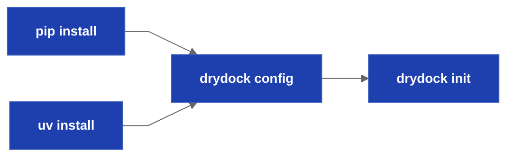
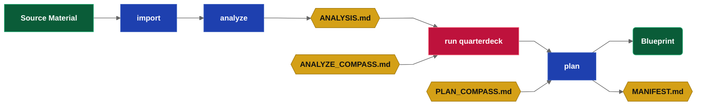

## What is Drydock

Drydock is a Specification driven software build pipeline.

**The Commander.** The user is known as the Commander. The Commander owns the product direction, reviews the work, and approves decisions.

Drydock imports specifications for your project - input specifications have no required format.

Drydock uses this material to create **Blueprints** which are an authoritative living definition of your software product. `drydock plan` turns imported source material into Blueprints and writes a **Manifest** (graph database) that tracks build order, runnable work, and incremental rebuild scope.

Blueprints represent the smallest building block for your software. Drydock groups related building blocks into blocks which are build steps and then builds software after combining the blueprints with enterprise Rigging.  Rigging provides governed business rules, technology rules, stack guidance, and branding that keep downstream builds focused on how to use a capability instead of reloading full authoring context every time.

Drydock uses test driven develiopment - each building block contains acceptance criteria which must succeed before moving to the next step. 

The process builds maintainable software.  Users can edit specifications or add change tickets, run `drydock refit`, and rebuild normally.

Quality is verified deterministically with a variety of `drydock score` commands.  These let the Commander understand the quality of the output softwre. based on programmatic acceptance criteria. 

The  Quarterdeck is a dedicated web console enabling the Commander to understand and guide the build.  Blockers, decisions, questionaires, and build progress are all available in the Quarterdeck.


### Glossary

| Drydock term | Meaning |
|---|---|
| Commander | The operator; the Agile Product Owner. |
| Target | The named project under `$DRYDOCK_WORKSPACE/targets/<Target>`. |
| Blueprint | The Typed Specification files that define the product; the source of truth. |
| Manifest | The executable build plan and dependency graph, `MANIFEST.md`. |
| Frontier | The set of Manifest blocks that are runnable now. |
| QuarterDeck | The web review console between the Commander and the LLM process. |
| Compass | Persistent project guidance used by Drydock commands. |
| Rigging | Shared branding, stack rules, templates, and compact context derivatives. |
| Soundings | The per-story acceptance-criterion verification board; Sea Trials is the project-level gate. |
| Proof integrity | Static analysis that demotes a vacuous or tautological acceptance proof to UNVERIFIED, so a passing test cannot lift the score without actually proving behavior. |
| Sea Trials | Product-level objectives and proof-of-delivery criteria. |
| Refit | Change process that maps updates into the manifest. |
| Crew | The LLM agents that perform the work. |
| Block | A group of Manifest stories built as one unit. |
| Spike | A Manifest block that answers a question; its finding feeds later work. |
| Tier | A Rigging file's rank in the build chain. |

## The drydock CLI

```text
drydock <verb> [<sub-verb>] [arguments] [--options]
```

Each project's `<Target>` uses a Workspace of `$DRYDOCK_WORKSPACE/targets/<Target>` and builds to `$DRYDOCK_BUILD_DIRECTORY/<Target>`.  The llm actions are scoped to these directories and may not operate outside of them.

## End-to-End Command Flow

A Target runs from source material to a scored release and through subsequent change with the
following commands.

```bash
# S — Set Up
drydock init MyApp                  # create the workspace

# A — Analyze and Plan
drydock import MyApp ./notes        # load specifications
drydock analyze MyApp               # stories, questions, blockers
drydock run quarterdeck MyApp       # review and answer
drydock plan MyApp                  # Blueprints and Manifest
drydock plan verify MyApp           # check acceptance criteria run
                                    # on failure: drydock plan repair MyApp
drydock run quarterdeck MyApp       # review the Manifest

# I — Implement
n=1
max=5
while drydock status MyApp --ready
do
    echo "*** BUILD ATTEMPT $n ***"
    drydock build MyApp || drydock diagnose MyApp --apply || true
    n=$((n+1))
    if [ "$n" -ge "$max" ]
    then
        echo "hit $max build attempts - aborting"
        exit 1
    fi
done
drydock status MyApp --check        # Manifest complete

drydock score ac MyApp              # story acceptance
drydock score build MyApp           # build evidence
drydock score release MyApp         # release gate

# L — Loop
drydock refit MyApp                 # map changes into the Manifest
                                    # then rerun the build loop
```

## SAIL Phase 1 — Set Up: Laying the Keel

Install Drydock, configure runtime defaults, and create a workspace for a Target build.
Process environment variables override values stored in Drydock's user-scoped `.env`.



### Installation Instructions

**Prerequisites**

- Python 3.11 or later
- A subscription-authenticated CLI: `claude` (Anthropic) or `codex` (OpenAI) or token oriented `gemini` (Google).

**Install**

```bash
uv tool install drydock-sdd
# or: pipx install drydock-sdd
```

`uv tool` and `pipx` place `drydock` on `PATH` automatically.

**Configure the workspace**

`$PROJECTS` is the directory where you wish keep your built software.

```bash
drydock config set drydock_workspace "$PROJECTS/drydock"
drydock config set drydock_build_directory "$PROJECTS"
```

**Initialize the target workspace**

```bash
drydock init <Target>
```

The resulting layout:

```text
$PROJECTS/
├── drydock/                    # Drydock workspace
│   └── targets/<Target>/       # Created by drydock init - Project Workspace
└── <Target>/                   # Final Build Location for projects
```

### General Setup Commands

```text
drydock --help
drydock --version
drydock config show
drydock config set <key> <value>
drydock init <Target> [--display-name <name>] [--description <desc>]
drydock status [<Target>] [--check | --ready]
drydock run quarterdeck [<Target>] [--host HOST] [--port PORT]
```

### drydock status

`drydock status` provides project status. With no arguments it shows all initialized projects. 
`drydock status <target>` provides project status for the defined <Target>.

`drydock status <Target> --check` and `drydock status <Target> --ready` are deterministic
pipeline gates used to identify if the project contains work to be done. Neither calls an LLM or writes files.

| State | `--check` | `--ready` |
|---|---|---|
| Complete — every story and spike is `closed/verified` | `0` | `1` |
| Buildable — approved work remains | `1` | `0` |
| Blocked — no/unparsable/draft Manifest, no executable work, or unknown Target | `2` | `1` |

`--check` reports the terminal state; `--ready` is the build-loop guard:

```bash
while drydock status <Target> --ready
do
    drydock build <Target>
done

drydock status <Target> --check   # 0 complete, 2 blocked
```

### drydock config

`drydock config` establishes user-scoped defaults.

| Variable | Purpose |
|---|---|
| `drydock_build_directory` | Build root |
| `drydock_workspace` | Workspace root |
| `change_ticket_directory` | Refit ticket directory |
| `drydock_model` | Default model |
| `drydock_effort` | Reasoning effort |
| `drydock_build_escalate_model` | Model for the final repair attempt |
| `llm_provider` | LLM CLI: `claude`, `codex`, or `gemini` |
| `codex_sandbox` | Codex OS sandbox policy |
| `prompt_warn_tokens` | Prompt size that warns |
| `prompt_error_tokens` | Prompt size that fails |
| `block_min_savings` | Shared tokens needed to group two stories |
| `quarterdeck_port` | QuarterDeck port |
| `diagnose` | Diagnose failures automatically |
| `sandbox_mem_limit` | Acceptance-run memory cap (MB) |
| `capture_output_limit` | Captured command output cap (MB) |
| `repair_attempts` | Repair passes per failed block |
| `repair_stall_limit` | Passes without progress before repair stops |
| `max_output_tokens` | Output tokens per response |
| `haiku_thinking_tokens` | Haiku thinking budget |

### drydock init

`drydock init <Target>` creates the temporary workspace for the Target under `$DRYDOCK_WORKSPACE/targets/`. Use `--display-name` to set a human-readable project name and `--description` to seed the one-line project summary in Target metadata.

## SAIL Phase 2 — Agile Analyze: Charting the Course

The Analyze phase turns imported source material into an Analysis for review, then into an executable Manifest for build.

1. `drydock import` brings source material into the Drydock workspace.
2. `drydock score spec` (optional) scores your imported specifications.
3. `drydock analyze` derives stories, acceptance milestones, blockers, questions
4. `drydock run quarterdeck` starts web server for Commander review
5. `drydock plan` creates Blueprint files and the Manifest.

> **Definition — Compass Files**
>
> Compass files hold Commander guidance for the project and for specific phases.
> `COMPASS.md` is inserted into every command. 
> `PLAN_COMPASS.md` is inserted into `drydock plan`. 
> `ANALYZE_COMPASS.md` is inserted into `drydock analyze`. 
> `MANIFEST.md` is the non-hand-editable directives for `drydock build`. 
> Compass files let the Commander define goals, constraints, and definition of done.

### Commands

```text
drydock import <Target> <Source> --format <auto|markdown|source|speckit|compass> [--force]
drydock score spec <Target>
drydock analyze <Target>
drydock run quarterdeck [<Target>] [--host HOST] [--port PORT]
drydock plan [--overwrite] [--no-conform] <Target>
```



### drydock import

`drydock import <Target> <Source> --format <auto|markdown|source|speckit|compass>` is the intake step.
It brings external material under Drydock control. Drydock copies the selected source material into
the Target workspace for later analysis. Compass imports write `COMPASS.md` at the Target root.

`drydock import <Target> <Source File> --format markdown` 
`drydock import <Target> <Directory> --format markdown` 
`drydock import <Target> <Source> --format <source|speckit>` 
`drydock import <Target> <Source> --format compass`  # existing `COMPASS.md` is preserved unless
`--force` 
`drydock import <Target> --update` refreshes the imported snapshot from the recorded source root
and records a new source version. `<Source>` is not accepted with `--update`.

Imported source files must be UTF-8. A file that fails UTF-8 decoding is not analyzed.

### drydock score spec

`drydock score spec <Target>` diagnoses potential errors in the specification. 

### drydock analyze

`drydock analyze` reads imported source material and decomposes it into stories, questionaires, and blockers. 

**Input files**

| Artifact | Location | Purpose |
|---|---|---|
| `sources/*` | `blueprint/` | read only imported source material |
| `*COMPASS.md` | Target root | Project guidance and intent |
| `ANALYZE_COMPASS.md` | Target root | guidance for `drydock analyze` |
| `BLOCKERS.md` | Target root | Identified blockers (from prior runs) |
| `questionnaires/*.json` | `QuarterDeck/` | Persistent questionaires created by `drydock analyze`. |

**Output files**

| Artifact | Location | Purpose |
|---|---|---|
| `BLOCKERS.md` | Target root | Questions on any blockers the LLM has found. Existence implies blockers.  Edit to resolve them. |
| `ANALYSIS.md` | Target root | Decomposition, story list, blockers, questions, and recommendations |
| `SEA_TRIALS.md` | Target root | Project acceptance criteria and release objectives |
| `COMPASS.md` | Target root | Created if absent. Constitution/Intent. |
| `questionnaires/*.json` | `QuarterDeck/` | Commander questionnaires |
| `commanders_chair.html` | `QuarterDeck/` | Summary view |

The most important guard is `BLOCKERS.md`. If `BLOCKERS.md` exists, the Commander edits it and reruns `drydock analyze` until the blockers are cleared. `SEA_TRIALS.md` captures project success criteria. 

### Specification Decomposition Methodology

Drydock decomposes source material into blueprints based on project type. For example, a web application will decomposes by route with stories that building the routes and stories building the screens. A screen can use multiple routes.

Other applications decompose using different methods.

| System Type | Methodology |
|---|---|
| Web application | HTTP routes — `GET /catalog` |
| CLI tool | Commands and sub-verbs |
| Library or package | Public API contract — `Database.items.get` |
| Data pipeline | Datasets, tables, process, inputs, and outputs |
| Event-driven | Topics, queues, and event types |

### Agile Story Refinement with drydock run quarterdeck

> **Definition — QuarterDeck**
>
> The QuarterDeck is a web console that renders the LLM's Markdown output.
> The Commander uses it to communicate with the Crew.

`drydock run quarterdeck` starts the web console. It is your helm. Navigate to the listed host and port.

The QuarterDeck shows status, blockers, questionaires, decisions, and activity with interactive screens that the Commander can use to approve or respond.

THe commander must define the technology stack in the quarterdeck by selecting available Rigging.  Rigging is required to build and use each component technology.

### drydock plan

`drydock plan` converts the reviewed analysis into blueprints which are stored under `<Target>/blueprint/` and
writes the build graph (`MANIFEST.md`). 

**Input files**

| Artifact | Location | Purpose |
|---|---|---|
| `sources/*` | `blueprint/` | Imported sources |
| `ANALYSIS.md` | Target root | Reviewed analysis |
| `PLAN_COMPASS.md` | Target root | Planning and grouping guidance |
| `COMPASS.md` | Target root | Project guidance |
| `questionnaires/*.json` | `QuarterDeck/` | Resolved decisions |
| `SEA_TRIALS.md` | Target root | Project acceptance criteria |

**Output files**

| Artifact | Location | Purpose |
|---|---|---|
| `ARCHITECTURE.md`,<br> `DATABASE.md`,<br> `FEATURE-{Name}.md`,<br> `SCREEN-{Name}.md`,<br> `UI-GENERAL.md` | `blueprint/` | Blueprints |
| `MANIFEST.md` | Target root | Build plan |

## SAIL Phase 3 — Implement: Building The Software

Builds the Blueprints using the Manifest.

* `drydock build status <Target>` shows the build steps.
* `drydock build <Target>` runs them.
* `drydock score` measures delivery health.
* Rigging applies company standards and branding.

### Commands

```text
drydock build <Target> [--continue] [--step <id|name>] [--story <id|name>]
                       [--ungate] [--reset] [--dry-run] [--show-prompt]
                       [--normalize-order] [--build-dir <path>]
                       [--repair-attempts <n>] [--escalate-model <model>]
drydock build status <Target>
drydock score ac <Target> [--step <id>] [--full]
drydock score release <Target>

drydock document generate <Target> [--model <model>]
drydock document assemble <Target> [--theme <theme>]
drydock document assemble readme <Target>
drydock document <Target> [--model <model>] [--theme <theme>]

drydock publish <Source.md> --output <Output.html> [--theme <theme>] [--flatten]
                [--pdf] [--pdf-output <Output.pdf>]

drydock validate <Target> [--verbose]

drydock rigging --add --file <path>
drydock rigging --add --dir <path>
drydock rigging compact <Target> [--all] [--force]
                                 [--include-file <file.md>] [--exclude-file <file.md>]
                                 [--include-dir <dir>]
drydock rigging update <Target> [--dry-run]
drydock rigging verify <Target>
```

### Build Planning with The Quarterdeck

The Commander can review `MANIFEST.md` in the QuarterDeck to set build direction and instructions.

The Manifest is the final plan. It groups similar steps to reduce context and orders stories
Foundation → Data and Persistence → Features → User Interface. Each step shows its estimated counts.
The Commander can:

* reorder stories so important or testable steps run first
* regroup stories so one agent runs them
* review Blueprint programmatic and user acceptance

Without story planning, the LLM's default order stands.

The Manifest titles each build step, and the steps are built in turn. Passing programmatic
acceptance unlocks the dependent steps:

```bash
drydock build status <Target>

while drydock status <Target> --ready
do
    drydock build <Target>
    drydock build status <Target>
done
```

### drydock build

`drydock build` converts Blueprints to code. It executes ready blocks from the `MANIFEST.md` in order.

Each building block or story is checked against its deterministic acceptance criteria and the 
block is only marked completed when all pass.  `drydock build` self repairs and will attempt to
diagnose and fix failed blocks and then resume.

Failed block get a configurable (default 6) number of  repair passes. 
Repair stops after two consecutive passes without progress, or at the pass limit.

**The build loop**

The analysis stage decomposes your epic and inputs, the plan stage grooms the stories and adds
acceptance criteria, and the build stage iterates the stories and builds them. `drydock diagnose` is
authorized to fix your specifications and correct prior step errors so the build can be retried.
Decisions are shown in the QuarterDeck.

```bash
n=1
max=5
while drydock status "$PROJECT" --ready
do
    echo "************************"
    echo "* RUNNING BUILD ATTEMPT $n"
    echo "************************"
    drydock build "$PROJECT" $OPTS || drydock diagnose "$PROJECT" --apply
    n=$((n+1))
    if [ "$n" -ge "$max" ]
    then
        echo "hit $max build iterations - aborting"
        exit 1
    fi
done
```

`drydock diagnose` writes a diagnostic report and recommends Blueprint changes. `--apply` updates the
Blueprints and invalidates their build graph, so the build self-repairs and continues.

The QuarterDeck surfaces these decisions for review. Review is generally pro forma: `drydock diagnose`
knows your intent because your Compass files state it.


`drydock build <Target>` writes the application to `$DRYDOCK_BUILD_DIRECTORY/<Target>`.

Before building, `drydock build` copies each imported source the Analysis marks `stage` from
`blueprint/sources/` to `<build_dir>/sources/`. Staged assets are read-only and recorded by digest.
A step that modifies one fails and the asset is restored; `drydock score` reports a modified asset
as a release blocker.

| Flag | Effect |
|---|---|
| `--continue` | Resume the frontier in place (default) |
| `--step <STEP>` | Build one block, or the block containing a story |
| `--story <STORY>` | Build one story, even inside a feature group |
| `--reset` | Discard prior work for the selected block; with no selector, reset every block and wipe the build directory |
| `--ungate` | Mark prior acceptance failures UNVERIFIED and continue; execution and dependency failures stay gated |
| `--repair-attempts <n>` | Repair passes after a failed block (default 6) |
| `--escalate-model <model>` | Model for the final repair attempt |
| `--normalize-order` | Normalize Manifest group order before building |
| `--build-dir <path>` | Build directory for this run |
| `--dry-run` | Preview the next step; no LLM call, no writes |
| `--show-prompt` | With `--dry-run`, print the assembled prompt |

Before building, `drydock build` checks applied Blueprint files for drift. On drift it stops and
directs the Commander to `drydock refit`.

**Input files**

| Artifact | Location | Purpose |
|---|---|---|
| `COMPASS.md` | Target root | Always injected |
| `MANIFEST.md` | Target root | Build plan and dependency graph |
| `ARCHITECTURE.md`, `DATABASE.md`,<br> `FEATURE-{Name}.md`, <br>`SCREEN-{Name}.md`,<br> `UI-GENERAL.md` | `blueprint/` | Typed Specifications for the current step |
| Imported sources | `blueprint/sources/` | Assets marked `stage`, copied to the build directory |

**Output files**

| Artifact | Location | Purpose |
|---|---|---|
| Built application files | `<Target>` | Built application; `build_dir:` in `METADATA.md` overrides the location |
| Staged build assets | `<Target>/sources/` | Test corpora, harnesses, and fixtures the build executes |

Build status appears on the QuarterDeck Manifest page and in `drydock build status`.

### drydock build status

```text
drydock build status <Target>
```

`drydock build status` reads `MANIFEST.md` and the runtime logs and prints each block's state and
the runnable frontier.

### drydock score

```text
drydock score spec <Target>
drydock score ac <Target> [--step <id>] [--full]
drydock score build <Target>
drydock score release <Target>
drydock score report <Target>
drydock score drydock
drydock score <Target>
```

`drydock score` audits specifications, verifies acceptance, reports build evidence, and evaluates
release readiness.

| Command | Behavior |
|---|---|
| `score spec` | Advisory findings on imported sources; writes `SPECIFICATION_SCORECARD.md` |
| `score ac` | Verifies every acceptance criterion, with no LLM; writes `SOUNDINGS.md` |
| `score build` | Reports repairs, tokens, and cache hit rate |
| `score release` | Runs the acceptance gate, then an LLM judges `SEA_TRIALS.md` |
| `score report` | Publishes the build receipt to `drydock_receipt/index.html` |
| `score drydock` | Advisory assessment of Drydock; writes `docs/drydock_planning/` |
| `score <Target>` | Summarizes the last run of each score |

`score ac` marks each criterion `✓ PASS`, `✗ FAIL`, `~ PREPASSED`, or `— UNVERIFIED`; a vacuous
proof is `UNVERIFIED`. `--step <id>` verifies one feature or story without updating `SOUNDINGS.md`.
`--full` prints untruncated failures.

`score spec`, `score ac`, `score build`, and `score release` regenerate `SCORECARD.md`, stamping
their verdict and timestamp.

A `measurement` criterion runs `Command:` in the build directory and compares its value to `Target:`
using `Operator:`. `Extract:` is a regular expression that reads the value from standard output;
without it, the command prints `{"value": <number>, "unit": "<unit>"}`.

### drydock document

```text
drydock document generate <Target> [--model <model>]
drydock document assemble <Target> [--theme <theme>]
drydock document <Target> [--model <model>] [--theme <theme>]
drydock document assemble readme <Target>
```

`drydock document` creates Target documentation from the Blueprint.

`generate` uses the LLM to write the configured `DOC-*.md` files to
`$DRYDOCK_BUILD_DIRECTORY/<Target>/docs/`. It overwrites them without warning.

`assemble` builds browsable documentation from those files. It uses no LLM and never modifies
`DOC-*.md`, so hand edits survive.

`drydock document <Target>` runs `generate`, then `assemble`.

`assemble readme` regenerates the built project's `README.md`.

Configuration lives in `$DRYDOCK_WORKSPACE/targets/<Target>/documentation.yaml`:

```yaml
theme: slate
sections:
  - OVERVIEW
  - FEATURES
  - SCREENS
  - ARCHITECTURE
  - SCHEMA
  - FLOWS
  - PIPELINE
  - SIGNALS
```

`sections:` sets the navigation order. CLI flags override configuration. Themes are `slate`,
`harbor`, and `paper`.

### drydock publish

```text
drydock publish <Source.md> --output <Output.html> [--theme <theme>] [--flatten]
                [--pdf] [--pdf-output <Output.pdf>]
```

`drydock publish` renders a front-matter Markdown document, such as a white paper, to HTML. It is
deterministic and calls no LLM. Front matter sets the title, author, studio, cover text, theme, and
formatting. Themes are `sail`, `slate`, and `paper`.

`--flatten` publishes each H1 and H2 section as a separate page with navigation. `--pdf` also renders
a PDF with the local browser.

```bash
drydock publish docs/Drydock_Specification.md --output docs/index.html
drydock publish docs/Drydock_Specification.md --output dist/Drydock_Whitepaper.html --theme sail --pdf
```

## SAIL Phase 4 — Loop: The Refit

A Refit updates the application while keeping the Blueprint and built software aligned. Change
tickets become build inputs, and drifted specifications map back into the build loop.

### Commands

```text
drydock diagnose <Target>
drydock diagnose <Target> --apply
drydock diagnose <Target> --no-apply
drydock diagnose <Target> --run <stamp>

drydock refit <Target>
```


### drydock diagnose

`drydock diagnose` explains why a Target's latest run stopped. It reads the workflow state, command
history, and run logs, and reports the milestone reached — `INIT`, `ANALYZE`, `PLAN`, `BUILD`, or
`SCORE` — and what stopped it. The milestone is deterministic and prints before any model call.

It separates a real defect from the failures that follow it. Exhausted retries, a stage a later stage
already answered, and a non-zero exit used as a state signal are each named, so the Commander does
not repair work that is not broken.

It writes `DIAGNOSE_<stamp>.md` and `DIAGNOSE_<stamp>.html` to the Target directory: Root Cause,
Details, Commander Feedback Requested, Repair Proposal, and the log files with their checksums.
Commander Feedback Requested lists the next steps and the open items from `BLOCKERS.md` and
`DECISIONS.json`. The report stands alone: a reader who did not see the run can repair from it.

It proposes amendments as unified diffs against the failing blocks' Blueprints, the Compass files,
and `MANIFEST.md`. Each is verified to apply and confirmed one at a time. Declined, failed, and
applied amendments are recorded in `DECISIONS.json`. `--apply` applies every verified amendment
without prompting; `--no-apply` records them and changes nothing. A Blueprint amendment resets the
blocks that consume it to pending. Applied amendments are committed to the Target repository.
Imported sources and change tickets are never patched.

`drydock diagnose` makes one LLM call and never edits Drydock's own source.

### drydock refit

`drydock refit <Target>` maps changes into the Manifest. It writes normalized change tickets,
updates `MANIFEST.md`, and resets affected built work. It does not modify Blueprints.

Changes are tickets (Jira or plain English), direct Blueprint edits, and Feature-ticket Blueprint
comments. Edits are detected against the Blueprint snapshot in the Manifest.

Tickets are read from and written to `change_ticket_directory` (default `blueprint/changes/`). Each
normalized ticket amends exactly one Blueprint, section, story, or database Access Pattern. A ticket
that cannot be incorporated is listed in `BLOCKERS.md`, and Refit fails.

A normalized ticket has typed front matter (`kind`, `operation`, `compatibility`, `create_dtm`,
`source_dtm`, `parent`) and the sections `## Change`, `## Contract Delta`, `## Source Evidence`,
`## Acceptance Conditions`, and `## Impact`.

Refit resets only built work a ticket affects; unbuilt work builds from the current requirement.
Updates are atomic, and Refit commits every artifact it writes to the Target repository.

A `DATABASE.md` Schema or Migration change affects only database work. An Access Pattern change
declares `compatibility`: `rebuild` also rebuilds the Features that cite it, `data` affects only
database work, and `unchanged` resets nothing.

## Directory Layout

Each Target has a workspace at `$DRYDOCK_WORKSPACE/targets/<Target>` and builds to
`$DRYDOCK_BUILD_DIRECTORY/<Target>`. The QuarterDeck reads its configuration and Markdown from the
workspace.

```text
$DRYDOCK_WORKSPACE/                       # explicit config/env or Git top-level — required
├── logs/
│   ├── history.jsonl                     # append-only drydock executions
│   ├── llm.jsonl                         # append-only llm executions
│   └── *.log                             # command logs
└── targets/
    └── <Target>/                         # one self-contained project
        ├── METADATA.md                   # identity: Blueprint name, code_root, status, stack
        ├── README.md                     # short human introduction to the project
        ├── ANALYSIS.md                   # Planning Session analysis: quality, stories, blockers, questions
        ├── ANALYZE_COMPASS.md
        ├── BLOCKERS.md
        ├── COMPASS.md                    # project guidance: intent, constraints, guardrails
        ├── MANIFEST.md                   # the executable Manifest
        ├── PLAN_COMPASS.md
        ├── SCORECARD.md                  # score retrospective, stamped per command
        ├── SEA_TRIALS.md                 # Project AC — project-level acceptance criteria
        ├── SOUNDINGS.md                  # AC — calculated acceptance/readiness ledger
        │
        ├── blueprint/                    # the Blueprint — conformed Typed Specification
        │   ├── sources/                  # preserved unconformed import material
        │   ├── ARCHITECTURE.md
        │   ├── DATABASE.md
        │   ├── FEATURE-{Name}.md
        │   ├── SCREEN-{Name}.md
        │   ├── UI-GENERAL.md
        │   └── changes/
        │       └── TICKET-NNN-{Name}.md
        │
        └── QuarterDeck/                  # console state only; runtime served from the package
            ├── console.yaml
            ├── pages/
            │   └── overview.md
            ├── data/
            └── questionnaires/
                └── planning.json
```

```text
$DRYDOCK_BUILD_DIRECTORY/
└── <Target>/                             # application source tree built by drydock build
```

## The Manifest Graph Database

`drydock plan` creates `MANIFEST.md`, and the Commander edits it in the QuarterDeck. It groups
stories into blocks, sets build order, and holds each story's context and build status.

Order lets the Commander prioritize work. Grouping saves context when building similar Blueprints.

### Grouping Blocks

Blocks group stories. Phase, story type, and screen versus non-screen work are grouping boundaries;
tier is not. Two stories group only when their shared context exceeds `block_min_savings`, within the
block token target and acceptance-criteria ceiling.

The block is the atomic build unit. A dependency between stories or spikes inside one feature is
internal sequencing and does not block the feature. A feature runs only when every external
dependency is `closed/verified`, and closes only when all its stories, spikes, and feature-level `ac`
blocks are `closed/verified`.

### Block States

All block types use four states:

| State | Meaning |
|---|---|
| `pending` | Not run yet |
| `implemented` | Legacy work done state, waiting to be reconciled |
| `closed/verified` | Passed or accepted |
| `closed/failed` | Failed or rejected |

## The QuarterDeck — Agile Development Console

The QuarterDeck is where the Commander reviews LLM build output and makes decisions. Its screens
follow the Agile methodology.

The QuarterDeck is configuration-driven: one `QuarterDeck/console.yaml` plus per-Target Markdown and
JSON. It holds no logic; templates render the LLM output so the Commander can edit the Markdown
cleanly. It is documented in `QuarterDeck/README.md`.

**Standard artifacts.**

| Artifact | Purpose |
|---|---|
| **Commanders Chair** | Default view: mission and current state |
| **Soundings** | Acceptance checklist: each capability, its state, and evidence |
| **Sea Trials** | Objectives and success criteria for delivery |
| **COMPASS Files** | Persistent Commander guidance |

`drydock init <Target>` enables the QuarterDeck. Artifacts are idempotent; ID fields prevent status
from being overwritten.

**Blockers.** `drydock analyze` writes `BLOCKERS.md` only when questions prevent planning. When
present, Blockers appear first in the sidebar. The Commander answers them and reruns
`drydock analyze`; when all are resolved the file is deleted. Blockers are mandatory gates, distinct
from spikes.

## Drydock Rigging — Portfolio Governance

Rigging is the enterprise rules governing application behavior. After `drydock analyze`, the
Commander selects Rigging in a mandatory questionnaire.

The Rigging shipped with Drydock is the Author's build rules. Organizations should supply their own
stack, branding, and best-practice files. Every Drydock project conforms to Rigging.

**Drydock ships only Pythonic Rigging.** The Author works in Python and cannot test other languages;
collaborators should create Rigging for them.

Three layers govern agent behavior: business rules, stack rules, and branding.

**Business rules.** `BUSINESS_RULES.md` defines agent behavior: git workflow, project layout, script
conventions, and error handling. Its compact derivative, `BUSINESS_RULES_compact.md`, is injected into
the Target `AGENTS.md`; the full source stays in `Rigging/`.

**Stack rules.** `Rigging/stack/` holds one file per technology, prescriptive and standalone.

Every Rigging file declares a `**Tier:**` header. Tiers 1 to 5 are the foundation; each builds on the
tier before it, and a Target selects at most one Rigging file per kind. Tier 6 is the application.

| Tier | Name | Builds |
|---|---|---|
| 1 | `language` | The tree, the environment, the test runner. |
| 2.1 | `platform` | The one database. |
| 2.2 | `platform` | The one web server. |
| 2.3 | `platform` | The one command-line entry point. |
| 3 | `branding` | The palette, the typography, the voice. |
| 4 | `interface` | The shared UI shell. |
| 5 | `screen-foundation` | The screen idiom. |
| 6 | `application` | Every service and every screen. |

A tier is a rank within a phase; the chain repeats in every phase. Tier 6 stories are ordered by
`depends` alone. A Rigging file or story with no tier is tier 6.

**Branding.** `BRANDING_MAIN.md` defines the master palette, typography, and design philosophy.
Per-medium files (`BRANDING_DOCUMENTATION.md`, `BRANDING_WHITEPAPERS.md`, `BRANDING_WEBSITE.md`)
inherit from it. The built software uses the Rigging palette unless the imported specifications
define one; in that case, do not import branding.

### Compaction

Compaction creates `<file>_compact.md` from `<file>.md`: the callable surface, with no explanatory
detail.

The story that builds a capability may need the full file; later stories use the compact file. The
build graph selects full or compact automatically, and `drydock build` creates compact files as
needed.

`drydock plan` warns when a source is newer than its compact file. Recompact it, which may trigger a
rebuild, or `touch` the compact file to keep it.

`--all` also refreshes Drydock's own Rigging compacts. Files with no callable surface are skipped and
marked in the file name.

### Commands

```text
drydock rigging --add --file <path>
drydock rigging --add --dir <path>
drydock rigging compact <Target> [--all] [--force]
                                 [--include-file <file.md>] [--exclude-file <file.md>]
                                 [--include-dir <dir>]
drydock rigging update <Target> [--dry-run]
drydock rigging verify <Target>
```

| Flag | Effect |
|------|--------|
| `--all` | Also refresh Drydock's own `Rigging/` compacts |
| `--force` | Skip the freshness check; recompact every file |
| `--include-file <file.md>` | Add a file (repeatable) |
| `--exclude-file <file.md>` | Drop a discovered file (repeatable) |
| `--include-dir <dir>` | Add all Markdown under a directory (repeatable) |

`drydock rigging update` injects `BUSINESS_RULES_compact.md` and standard templates into the Target
`AGENTS.md` idempotently; `--dry-run` previews without writing. `drydock rigging verify` checks
Rigging compliance.

## Drydock Security

Drydock checks dependency legitimacy during build to limit hallucinated or suspicious package names.

Drydock trusts imported material and **WILL** run it. Encapsulate it with Docker or bwrap
(bubblewrap) to guard against poor or malicious specifications. Drydock needs access only to
`$DRYDOCK_BUILD_DIRECTORY` and `$DRYDOCK_WORKSPACE`.

### Claude Security Details

Drydock runs the Claude CLI headless in an isolated home, `~/.drydock/claude-home`, seeded only with
subscription credentials. The agent reads none of the user's settings, plugins, MCP servers, history,
or state.

```bash
HOME=~/.drydock/claude-home CLAUDE_CONFIG_DIR=~/.drydock/claude-home \
claude -p \
    --verbose \
    --safe-mode \
    --output-format stream-json \
    --include-partial-messages \
    --dangerously-skip-permissions \
    --model <model>
```

| Flag | Effect |
|---|---|
| `-p` | Print mode: one prompt in, one response out |
| `--verbose` | Full event detail for the execution log |
| `--safe-mode` | No CLAUDE.md/AGENTS.md discovery, auto-memory, hooks, plugins, or MCP servers |
| `--output-format stream-json` | Structured JSON events for logging |
| `--include-partial-messages` | Stream token deltas to the console |
| `--dangerously-skip-permissions` | Run unattended; text-only commands pass `--tools "" --strict-mcp-config` instead |
| `--model <model>` | Configured model |

### Codex Security Details

Drydock isolates Codex's configuration and identity, not its command execution.

```bash
CODEX_HOME=/tmp/drydock-codex-home-XXXX \
codex exec \
    --ignore-user-config \
    --ignore-rules \
    --ephemeral \
    --sandbox <codex_sandbox> \
    --cd <build_dir> \
    --json \
    --output-last-message <output_file> \
    --model <model> -
```

| Flag | Effect |
|---|---|
| `CODEX_HOME=<dir>` | Temporary home seeded only with `auth.json`; no user config, rules, memories, or history |
| `--ignore-user-config` | Skip `$CODEX_HOME/config.toml` |
| `--ignore-rules` | Skip user and project `.rules` |
| `--ephemeral` | No persisted session state |
| `--sandbox <codex_sandbox>` | OS sandbox policy from `codex_sandbox` |
| `--cd <build_dir>` | Working root |
| `--json` | Structured event output |
| `--output-last-message <output_file>` | Capture the final message |
| `--model <model>` | Runtime model |
| `-` | Read the prompt from stdin |

Codex runs model-generated commands in the invoking shell. `codex_sandbox` is `danger-full-access`
(default, no OS confinement), `workspace-write`, or `read-only`. Non-default modes require the
platform sandbox helper (`codex-linux-sandbox` on Linux) and fail fast without it. Hardened
deployments run Drydock in a container that exposes only the workspace and build directories.

## Database Encapsulation

**`DATABASE.md` enforces data access encapsulation.**

Application code never calls the database directly. Every table, config store, file store, and
external service is accessed through a typed Python class. Route and business code calls
`db.items.get(id)`, never raw SQL.

A code review that finds raw SQL, `os.environ` reads, `open()` on application data, or a cloud SDK
import outside its encapsulation class fails.

**Typed class library pattern.** `DATABASE.md` specifies the schema and the Python classes that
encapsulate it. Each table maps to a typed `@dataclass` row. One `Database` class owns the
connection and session lifecycle and exposes only named methods; callers never receive a cursor or
row tuple. Methods raise domain exceptions (`ItemNotFound`, `StorageError`), not driver exceptions.
The `Database` class is created once at startup and passed by dependency injection.

`DATABASE_compact.md` holds only class names, method signatures, types, and one-line summaries. Only
the story that `implements: DATABASE.md` receives the full file; other steps receive the compact
form.
